<h1 align="center">Hi, I'm Vikas Rana 👋</h1>

  

  <a href="https://github.com/vikasrana1407">GitHub</a> ·
  <a href="https://github.com/vikasrana1407/Portfolio">Portfolio</a>

## About

I build practical software across AI/ML, Python, full-stack apps, and workflow automation. I enjoy taking ideas from a useful prototype to a polished product.

- AI-assisted products and developer tools
- Python APIs and full-stack applications
- Workflow automation with n8n

## Featured projects

| Project | What it is |
| --- | --- |
| [AI-Trader](https://github.com/vikasrana1407/AI-Trader) | Kotak Neo position-management bot for manually placed positions; review its trading-risk notes before use. |
| [FitStudio AI](https://github.com/vikasrana1407/AIFitnessStudio) | Multi-tenant fitness studio platform with class and generation-job workflows. |
| [AI Fashion Design Studio](https://github.com/vikasrana1407/Fashion_designer) | AI-assisted design studio with a gallery, collections, and outfit workflows. |
| [n8n Automations](https://github.com/vikasrana1407/n8n_Automations) | Self-hosted receptionist and LinkedIn workflow examples. |
| [Portfolio](https://github.com/vikasrana1407/Portfolio) | A responsive portfolio site with interactive sections and animated visuals. |

## Tools I work with

  
  
  
  
  

<i>Thanks for stopping by — explore a project or say hello!</i>

